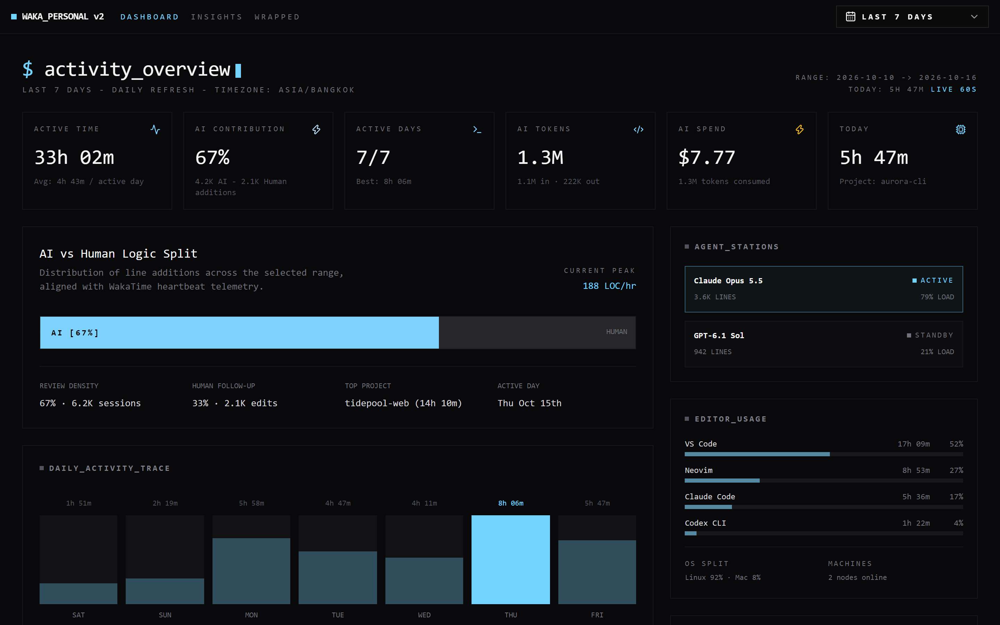
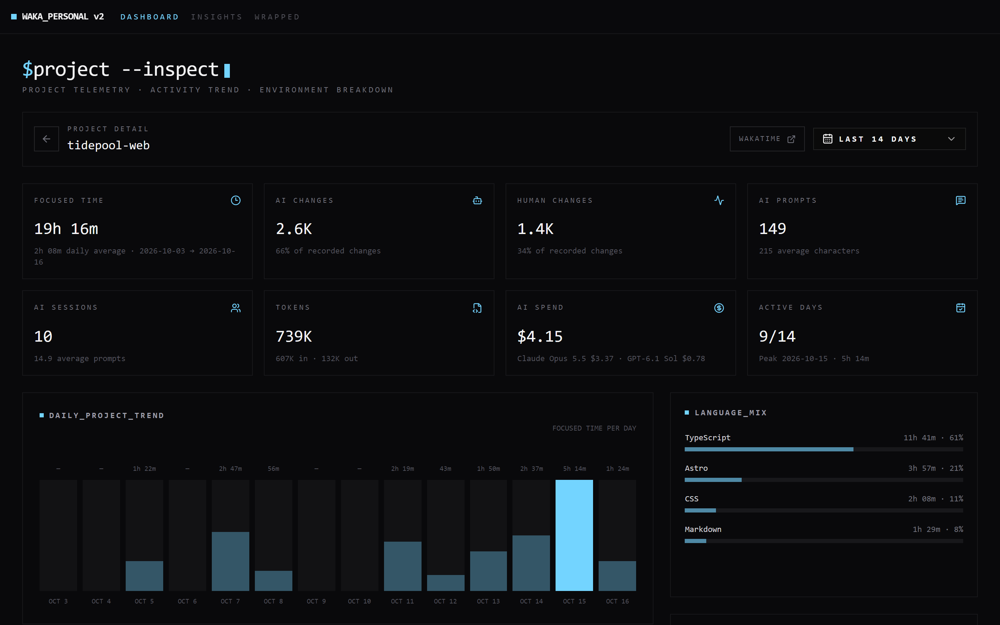
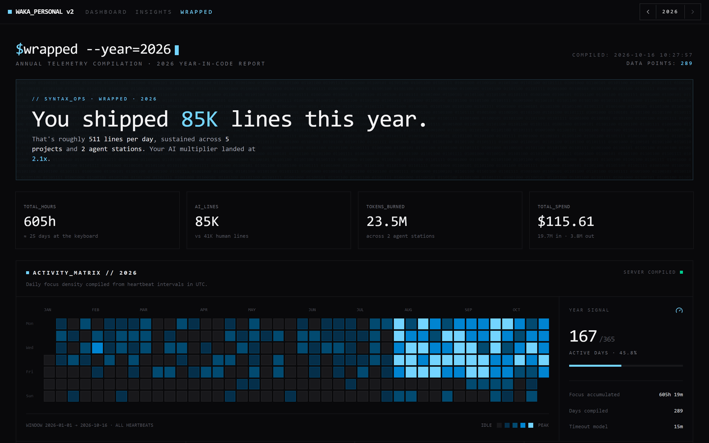
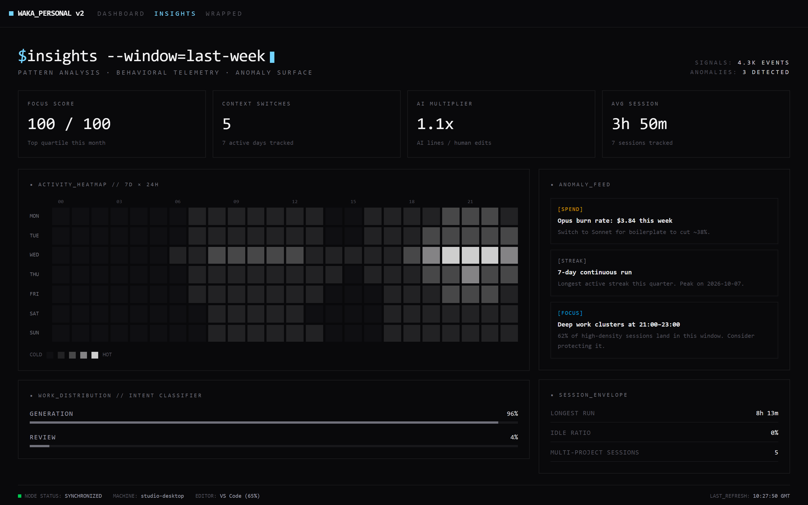

<div align="center">


# Waka Personal

**Your own WakaTime backend and coding dashboard, on your own server.**

Keep the WakaTime plugins you already use, but send every heartbeat to a database you control.
No subscription, no third-party account, no data leaving your machine.

[](https://github.com/dvgamerr-app/waka-personal/stargazers)
[](https://github.com/dvgamerr-app/waka-personal/releases)
[](https://github.com/dvgamerr-app/waka-personal/pkgs/container/waka-personal)

[Website](https://dvgamerr.app/waka-personal/) · [Quick start](#deploy-in-5-minutes) · [Self-hosting guide](docs/self-hosting.md) · [ภาษาไทย](README.th.md)





**⭐ If this saves you a WakaTime subscription, star the repo — it helps other developers find it.**

</div>

## Why

- **Own your coding history.** Every heartbeat lands in your PostgreSQL database, not someone else's.
- **Zero client changes.** Any WakaTime plugin works; change `api_url` and keep coding.
- **Self-hosting is one command.** Two settings in `.env`, then `docker compose up -d`.
- **Keep WakaTime too if you like.** `wakatime-cli` can send to Waka Personal and wakatime.com at the same time.

## Features

|     | Feature                     | What you get                                                                                     |
| :-: | :-------------------------- | :----------------------------------------------------------------------------------------------- |
| 🔌  | **WakaTime-compatible API** | Heartbeats, bulk ingest, durations, summaries, stats, status bar and file experts.               |
| 📊  | **Built-in dashboard**      | Daily totals, languages, projects, editors and a live view that refreshes every 60 seconds.      |
| 📁  | **Project detail**          | Drill into one project: files, branches, languages and time per day.                             |
| 💡  | **Insights**                | Focus score, session length, context switches and when your deep work happens.                   |
| 🎁  | **Wrapped**                 | An annual recap with an activity matrix, peak day, streaks and AI coding stats.                  |
| 🤖  | **AI coding telemetry**     | AI sessions and token usage, plus a model pricing table for cost estimates.                      |
| 📦  | **Backup importer**         | Import WakaTime `.json` and `.json.gz` exports from source; re-runs are deduplicated by SHA-256. |
| 🔐  | **Single-user auth**        | One API key, checked the same way WakaTime plugins send it.                                      |
| 🛡️  | **Production defaults**     | Rate limiting, security headers, health probes and a non-root container.                         |
| 🐳  | **Multi-arch image**        | `linux/amd64` and `linux/arm64` on GitHub Container Registry.                                    |

<details>
<summary><b>More screenshots</b></summary>

<br />





Screenshots use generated demo data.

</details>

## Deploy in 5 minutes

You need Docker with the Compose plugin on any Linux, macOS or Windows host.

1. Download the compose file and the environment template:

   ```shell
   mkdir waka-personal && cd waka-personal
   curl -fsSLO https://raw.githubusercontent.com/dvgamerr-app/waka-personal/main/docker-compose.yml
   curl -fsSL https://raw.githubusercontent.com/dvgamerr-app/waka-personal/main/.env.example -o .env
   ```

2. Edit `.env` and replace the two `REPLACE_ME` values:

   ```env
   APP_API_KEY=REPLACE_ME        # openssl rand -hex 24
   POSTGRES_PASSWORD=REPLACE_ME
   ```

3. Start it:

   ```shell
   docker compose up -d
   ```

4. Open `http://YOUR_HOST:8080` for the dashboard, then point your editor at it:

   ```ini
   # ~/.wakatime.cfg
   [settings]
   api_url = http://YOUR_HOST:8080/api/v1
   api_key = REPLACE_ME
   ```

The database schema is created on first start. For HTTPS, backups, upgrades and importing old
data, read the [self-hosting guide](docs/self-hosting.md).

## Use it

The API speaks the WakaTime protocol, so plugins just work. You can also call it directly:

```shell
curl -u "REPLACE_ME:" http://YOUR_HOST:8080/api/v1/users/current/statusbar/today
```

WakaTime plugins send the API key as the Basic-auth username, which is why the password is empty.

## Architecture

```text
 Editor plugins ──► wakatime-cli ──► /api/v1  ┐
                                              ├─► Go API (Fiber) ──► PostgreSQL
 Browser ─────────► dashboard ────► /api/v2  ┘        │
                                                      └─ serves the Astro dashboard
```

One Go binary (Fiber, pgx, goose, zerolog) serves both the API and a static Astro + React
dashboard from the same origin, backed by PostgreSQL.

## Documentation

- [Self-hosting guide](docs/self-hosting.md): configuration, HTTPS, backups, upgrades, troubleshooting
- [Development guide](docs/development.md): run from source, full endpoint list, client config, importer, migrations
- [Activity metrics](docs/activity-metrics.md): how durations, streaks and AI token totals are calculated

## Develop

```shell
docker compose up -d postgres
bun install --frozen-lockfile
bun run build:dist
go run ./cmd/migrate up
go run ./cmd
go test ./...
bun run check
```

## Support the project

- ⭐ [Star the repository](https://github.com/dvgamerr-app/waka-personal/stargazers) so others can find it
- 🐛 [Report a bug or request a feature](https://github.com/dvgamerr-app/waka-personal/issues)
- 💖 [Sponsor the maintainer](https://github.com/sponsors/dvgamerr)

Waka Personal is an independent project and is not affiliated with WakaTime.
